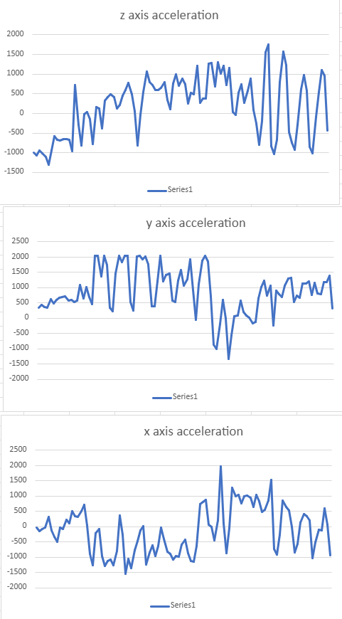

# Project Notes

[toc]

## Steps
- [ ] get position from accelerometer every time period  **Ensure they're not just random numbers**

- [ ] append position to array

- [ ] print new position to file

- [ ] read positions from file to python and change to graph

  

  

## Project log

### Day 4 - 14/7
- [ ] 
### Day 3 - 16/7 
- [x] try another graph(with the csv converted to excel)
- [ ] try to change mu save location(add a shortcut?)
- [ ] see what axis are most important
- [ ] try to see what the acceleration means(make decipherable graph)+(diagram of axis on the micro:bit)
- [ ] do actual walking test to get graphs for that
- [ ] functional requirements of minimumparallel.py 
- [ ] finish plans for minimum parallel from yesterday

### Day 2 - 15/7

> With this type of step counter, the number of zero crossings or peaks of the vertical acceleration of the body versus time curve is used to determine the number of steps. 
- [ ] set a minimum, and then have a step be counted every time that minimum is crossed <mark style = "background-color :  lightblue;">minus minimum from all other data to find relatives</mark> /
- got the micro:bit to make a file
- wrote positions into the file **must be strs**
- exported file to new program and printed as a mu graph
- made program to find min and max of each axis from the data file, find the midpoint and then 
- converted csv files with the data to excel spreadsheet 
- increased range of data being taken in, and tested for error caused by this

### Day 1 - 14/7

- familiarization with software being used
  (Mu, Git, Typora)
- writing basic micro:bit programs for testing and refamiliarization 
- writing basic micro:bit programs involving accelerometer
- attempted setting up the micro:bit for remote use
- wrote basic program to turn a small array into a graph
- got data for multiple loops
- put info into arrays and print arrays
- got info in all three axis

