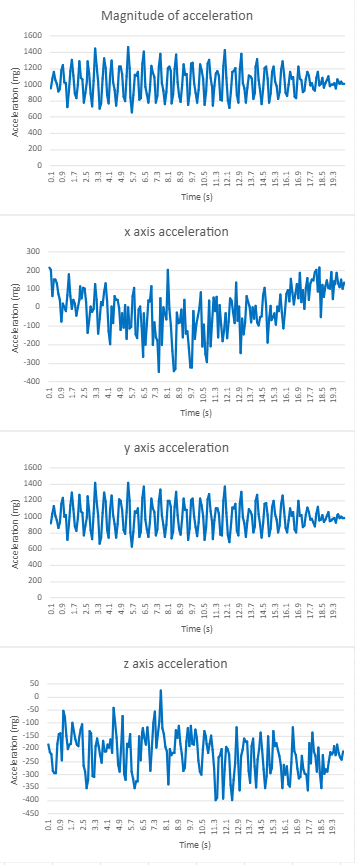
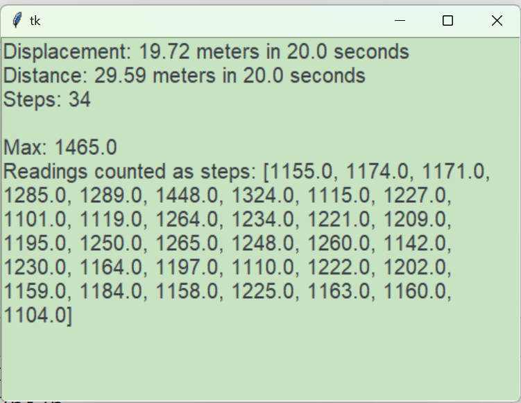
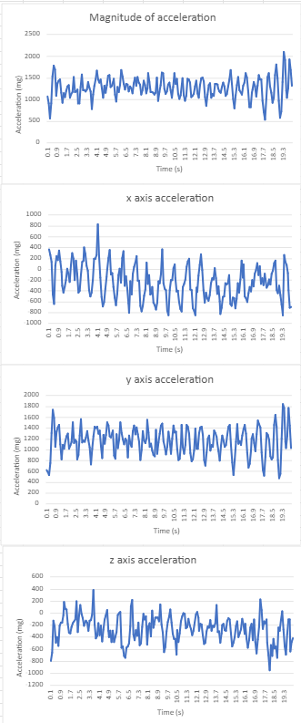
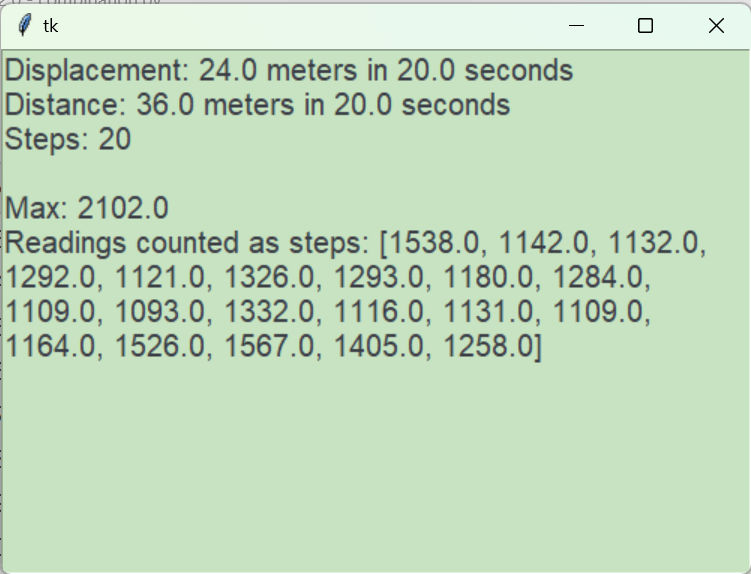
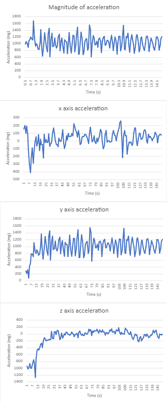
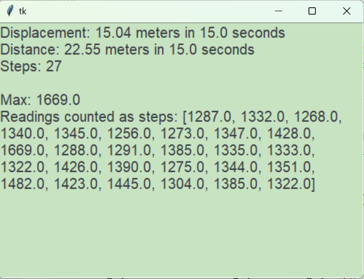
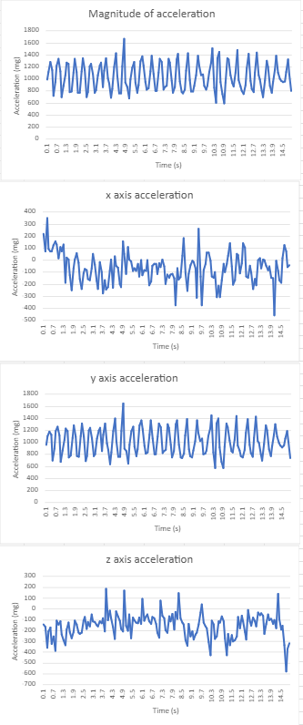
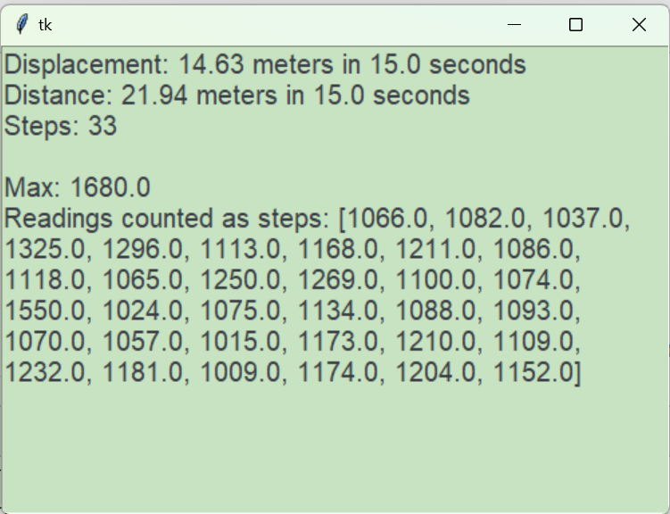

# Project Notes

[toc]

## Steps/Things to look at
- [x] get position from accelerometer every time period 

- [x] append position to array

- [x] print new position to file

- [x] read positions from file to python and change to graph

- [x] use data to measure SVT?

  ```python
  def getdisplacement(readingy):
      vel = 0
      dis = 0
      time = 0.1
      
      for loops in range(0, len(readingy)):
          acc = readingy[loops]/1000
          vel = vel + (acc)*time
          dis = dis + (vel*time) +(0.5 * acc *(time**2))
          
      dis = round(dis, 1)
  	return dis
  ```

  

- [x] see what positioning of pedometer are best, especially with calculating displacement(**seems like logo needs to be up for displacement to be positive**, **no arm swing also seems to give better results**) 

- [ ] try to find out how to increase range of micro:bit to prevent data loss(current max is 2040mg)  **code below doesn't work**  *attribute error*  
  
    ```python
    input.set_accelerometer_range(
        AcceleratorRange.FOUR_G)
    ```

- [x] calculate distance alongside displacement


``` python
for loops in range(0,len(x)):
	changex = ((velx * time) + (0.5 * accx * (time)**2))
    changey = ((vely * time) + (0.5 * accy * (time)**2))
   	changedist = ((changex**2) + (changey**2))**0.5
    dist = dist + changedist
```

- [ ] can it see the difference between activities (like stairs/walking)(ask remote) 

- [ ] differences in accuracy of data depending on positions of accelerometer on the body(belt/holding(swing/no swing)/leg) 

## SL7 To Do
- [ ] complete outcome 3 & 6
- [ ] finish Gantt chart


## Project log

end of last week - presentation

someone said something about a blog?

poster and report due 31/8
### Day 9 - 24/7
- aileen visiting in morning
- computer visit

### Day 8 - 23/7

- [ ] test combination.py more (accuracy) 

- [ ] decide what more to do with accelerometer(positioning)

- [ ] have a look at abstract and see if its true/ what evidence is needed to back it up that i don't already have

  

- [ ] continue report

- [ ] finish SL7 outcome 3 and start outcome 6

- [ ] check crest report requirements 

- [ ] do more of the Gantt 

### Day 7 - 22/7

- made Gantt chart for project
- completed further SL7 work
- added error logs back in to README.md
- wrote a Personal Development Plan
- did further poster design (added axis diagram)
- revised distance vs displacement and implemented new plan *think it works now*  
- collected and tested data with new displacement module
- tested how data looks when taken going upstairs
- made graphs for stairs data sets
- updated combi.py results for older data sets
- made further plans for reports, started writeup

### Day 6 - 21/7

- began to implement interface for display of outputs *doesn't kill program when close window* 
- implemented distance module and realized displacement one doesn't work *i think the distance one works but the displacement one doesn't work, (except with noswing data set* )
- collected data with arm swing to compare to data with no arm swing, made graphs(see images) **no arm swing gives better results for graphs, and more reliable step counting** 
- made a big program of both minimumparallel.py and displacementtest.py 
- read more articles for references 
- tried to set the range of the accelerometer again, *still doesn't work(attribute error)*
- started stem leader booklet

### Day 5 - 18/7


- tried to fix error in displacement calculating program *distance was calculated correctly, but displacement didn't, however because it was close to true on one data set, i didn't notice* 

- updated graph so that it uses magnitude of three axis, and then counts steps using percentage instead of chosen number 

- updated minimumparallel.py so that it uses magnitude to count steps instead of whatever axis i thought looked best, and uses the same step counting as the excel sheets

- tested pedometer with no swing of the arm (just held still) **no swing seems to give better results, especially on the y axis**

- started trying to get distance as well as displacement 

- made tidy graphs(labels,times) with no_swing data (see images)

### Day 4 - 17/7
- annotated accelerometer graph
- Attempted to increase the range of values measured by the accelerometer 
  *didn't work, have code that should work but doesn't* 
- collected further data with walks, checked accuracy of minparallel.py with these programs 
- revised the use of the integration of acceleration to find velocity and displacement 
- wrote initial pseudocode for displacement program **total acceleration?** 
- wrote initial program to find displacement(results seemed larger than they should) 

### Day 3 - 16/7 
- made graphs from data sets(csv converted to excel) produced when the micro:bit was shaken, stationary and walking(swinging while held)
- test of axis' to see which ones showed the movement the best(shown in graphs)  - program to visualize z and x axis changes
- wrote functional requirements of minimumparallel.py, and defined the program 
- read papers on accelerometer graphs (see References.md )

> With this type of step counter, the number of zero crossings or peaks of the vertical acceleration of the body versus time curve is used to determine the number of steps. 

- updated max and min finding program to count every time a reading is within range of the max, and used this to count the steps (with walking graphs average peaks can be found much easier, so this will work better) 

- did mock walking(swinging arm ) tests with larger arrays, made graphs and counted steps(graph peaks) with minimumparallel.py 

- tested the effect of orientation of the usability of graphs produced by data (*best ones to use are logo facing left/right, but right will use maxes and left will use mins, both will use x axis(**edit parameter passing in minimumparalel.py depending on what one is used , and changed whether int is being added to or taken away from**) *realised minparalle wasn't efficient, and ended up switching so it used magnitude to fix this* 

  

### Day 2 - 15/7


- got the micro:bit to make a file
- wrote positions into the file **must be strs** *file writing wasn't working because i'd forgotten how to do it*  
- exported file to new program and printed as a mu graph
- made program to find min and max of each axis from the data file, find the midpoint and then count every time the midpoint was met (didn't work, cos midpoints were used)*logic error in how i was trying to count the steps*  
- converted csv files with the data to excel spreadsheet 
- increased range of data being taken in, and tested for error caused by this

### Day 1 - 14/7

- familiarization with software being used
  (Mu, Git, Typora)
- writing basic micro:bit programs for testing and refamiliarization 
- writing basic micro:bit programs involving accelerometer
- attempted setting up the micro:bit for remote use *add* 
- wrote basic program to turn a small array into a graph
- got data for multiple loops
- put info into arrays and print arrays
- got info in all three axis

## Images

  
  


graphs and results for no swing walk test - magnitude of acceleration is include, however due to no swing, it is the same as the y axis acceleration graph (0.75)


  
   

graphs and results for arm swing test - magnitude of acceleration is still very similar to y axis, but now slightly different due to swing (0.5)


     

 

results from combination.py for climbing up stairs with no arm swing(0.75)


 

 

results from combination.py for climbing down stairs with no arm swing (0.6)

