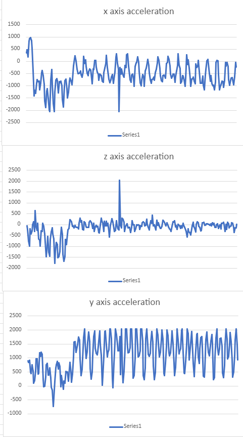
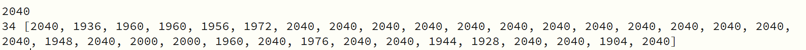

# Project Notes

[toc]

## Steps/Things to look at
- [x] get position from accelerometer every time period 

- [x] append position to array

- [x] print new position to file

- [x] read positions from file to python and change to graph

- [x] use data to measure SVT?

  ```python
  def getdisplacement(readingy):
      vel = 0
      dis = 0
      time = 0.1
      
      for loops in range(0, len(readingy)):
          acc = readingy[loops]/1000
          vel = vel + (acc)*time
          dis = dis + (vel*time) +(0.5 * acc *(time**2))
          
      dis = round(dis, 1)
  	return dis
  ```

  

- [x] see what positioning of pedometer are best, especially with calculating displacement(**seems like logo needs to be up for displacement to be positive**, ** no swing also seems to give better results**)  *maybe test more with the 4 directions* 

- [ ] try to find out how to increase range of micro:bit to prevent data loss(current max is 2040mg) 
  
    ```python
    input.set_accelerometer_range(
        AcceleratorRange.FOUR_G)
    ```


 

  

## Project log

### Day 6 - 21/7

- [ ] start to update displacement test so it calculates displacement and distance?
- [ ] have a look at stem leader stuff
- [ ] start plan for report

### Day 5 - 18/7


- [ ] go to talk thing @ 2 

- [ ] make a nice graph with walking() data (add time, labels, make them understandable) 

  

- tried to fix error in displacement calculating program 

- updated graph so that it uses magnitude of three axis, and then counts steps using percentage instead of chosen number 

- updated minimumparallel.py so that it uses magnitude to count steps instead of whatever axis i thought looked best, and uses the same step counting as the excel sheets *think that's the best way to count them, maybe check*

- tested pedometer with no swing of the arm( just held still) **no swing seems to give better results, especially on the y axis**

- started trying to get distance as well as displacement *just got 0.0 dk why* 

### Day 4 - 17/7
- annotated accelerometer graph
- Attempted to increase the range of values measured by the accelerometer 
  *didn't work, have code that should work but doesn't*
- collected further data with walks, checked accuracy of minparallel.py with these programs 
- revised the use of the integration of acceleration to find velocity and displacement 
- wrote initial pseudocode for displacement program **total acceleration?** 
- wrote initial program to find displacement, *results seem larger that they should be, but not by a significant amount, (even when arm isn't swung it still is more than it should be)*    

### Day 3 - 16/7 
- made graphs from data sets(csv converted to excel) produced when the micro:bit was shaken, stationary and walking(swinging while held)
- test of axis' to see which ones showed the movement the best(shown in graphs)  - program to visualize z and x axis changes
- wrote functional requirements of minimumparallel.py, and defined the program 
- read papers on accelerometer graphs (see References.md )

> With this type of step counter, the number of zero crossings or peaks of the vertical acceleration of the body versus time curve is used to determine the number of steps. 

- updated max and min finding program to count every time a reading is within range of the max, and used this to count the steps (with walking graphs average peaks can be found much easier, so this will work better) ( *could minus minimum from all other data to find relatives*   ? dk if its really needed but would make graph interpretation easier later on)

- did mock walking(swinging arm ) tests with larger arrays, made graphs and counted steps(graph peaks) with minimumparallel.py 

- tested the effect of orientation of the usability of graphs produced by data (*best ones to use are logo facing left/right, but right will use maxes and left will use mins, both will use x axis(**edit parameter passing in minimumparalel.py depending on what one is used , and changed whether int is being added to or taken away from**)

  

### Day 2 - 15/7


- got the micro:bit to make a file
- wrote positions into the file **must be strs** 
- exported file to new program and printed as a mu graph
- made program to find min and max of each axis from the data file, find the midpoint and then count every time the midpoint was met (didnt work, cos midpoints were used)
- converted csv files with the data to excel spreadsheet 
- increased range of data being taken in, and tested for error caused by this

### Day 1 - 14/7

- familiarization with software being used
  (Mu, Git, Typora)
- writing basic micro:bit programs for testing and refamiliarization 
- writing basic micro:bit programs involving accelerometer
- attempted setting up the micro:bit for remote use
- wrote basic program to turn a small array into a graph
- got data for multiple loops
- put info into arrays and print arrays
- got info in all three axis

